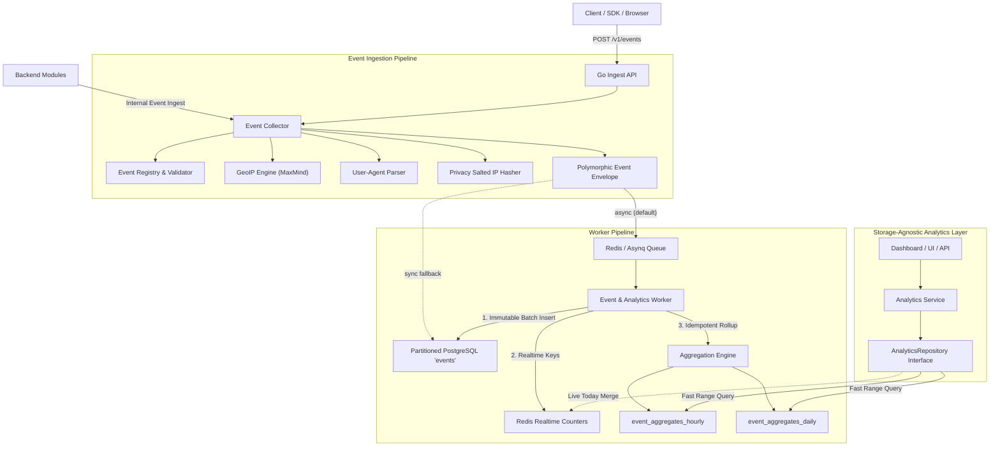

# Generic Event & Analytics Infrastructure Architecture

This document describes the design and operational model of the generic, polymorphic Event Tracking and Analytics Infrastructure.

---

## 1. High-Level Architecture

The system is designed for high-throughput, non-blocking telemetry ingestion, immutable audit storage, idempotent background rollups, and zero-raw-scan dashboard query performance.



---

## 2. Key Architectural Tenets

### 1. Completely Polymorphic & Domain-Agnostic
- The infrastructure contains **zero hardcoded references** to specific entities like `card_id` or `user_id`.
- Any entity is represented via `EntityReference`:
  ```json
  {
    "type": "card | user | company | payment",
    "id": "c79f9024-e910-410a-8d26-7fae879058b8"
  }
  ```
- Adding telemetry to any new domain model requires zero database schema migrations or changes to the ingestion and query pipelines.

### 2. High-Throughput & Non-Blocking Ingestion
- `POST /v1/events` validates the payload against the in-memory schema registry, enriches request context server-side, and enqueues to Redis Asynq in less than **5 milliseconds**, returning `202 Accepted`.
- Ingestion operates reliably under burst traffic without saturating PostgreSQL connection pools.

### 3. Server-Side Context Enrichment & Anti-Spoofing
- Clients **cannot spoof** IP addresses, geolocations, user agents, or referrers.
- All geographic metadata (`country_code`, `city`, `timezone`, `coordinates`) and client signatures (`device_type`, `browser`, `os`) are extracted server-side from HTTP transport headers and the GeoIP database.

### 4. Privacy-First (GDPR / KVKK Aligned)
- Raw IP addresses are **never stored** in the database.
- Salted HMAC-SHA256 hashes (`ip_hash`) are computed using rotating salts, enabling aggregate unique visitor estimations without enabling permanent cross-month user tracking.

### 5. Partitioned Raw Event Storage
- Raw events are stored immutably in PostgreSQL partitioned tables (`PARTITION BY RANGE (occurred_at)`).
- Partitions are created automatically in monthly chunks (e.g., `events_2026_08`, `events_2026_09`) with an `events_default` safety fallback.
- Automated partition maintenance ensures future partitions exist and prunes expired data cleanly.

### 6. Zero-Raw-Scan Analytics Queries
- Dashboards and reports **never scan millions of raw event rows**.
- Background workers idempotently rollup metrics into `event_aggregates_hourly` and `event_aggregates_daily`.
- Rollup rows are keyed by bucket, subject, event type and entry `source` (`qr`, `nfc`, `link`, `legacy` or empty, TEC-953); a separate `analytics_visitors_hourly` rollup (one row per visitor and hour) answers platform unique-visitor counts.
- Summary and timeline queries execute in single-digit milliseconds via indexed range queries on aggregate tables, merged with real-time Redis counters for today's live activity.

---

## 3. Future ClickHouse / OLAP Migration

The analytics query subsystem is architected behind the `AnalyticsRepository` domain interface:

```go
type AnalyticsRepository interface {
    GetSummary(ctx context.Context, filter AnalyticsFilter) (*Summary, error)
    GetTimeSeries(ctx context.Context, filter AnalyticsFilter) (*TimeSeriesResult, error)
    GetBreakdown(ctx context.Context, filter AnalyticsFilter, dimension string) (*BreakdownResult, error)
    GetTopEvents(ctx context.Context, filter AnalyticsFilter, limit int) ([]EventTypeCount, error)
    GetRawEvents(ctx context.Context, filter RawEventFilter) (*RawEventListResult, error)
}
```

When scale grows to billions of events:
1. Implement `ClickHouseAnalyticsRepository` satisfying `domain.AnalyticsRepository`.
2. Configure the ClickHouse worker sink to stream raw events into ClickHouse.
3. Swap the repository implementation in `httpserver/server.go`.
4. **Zero changes** are needed in HTTP routes, domain models, validation logic, or frontend client code.
