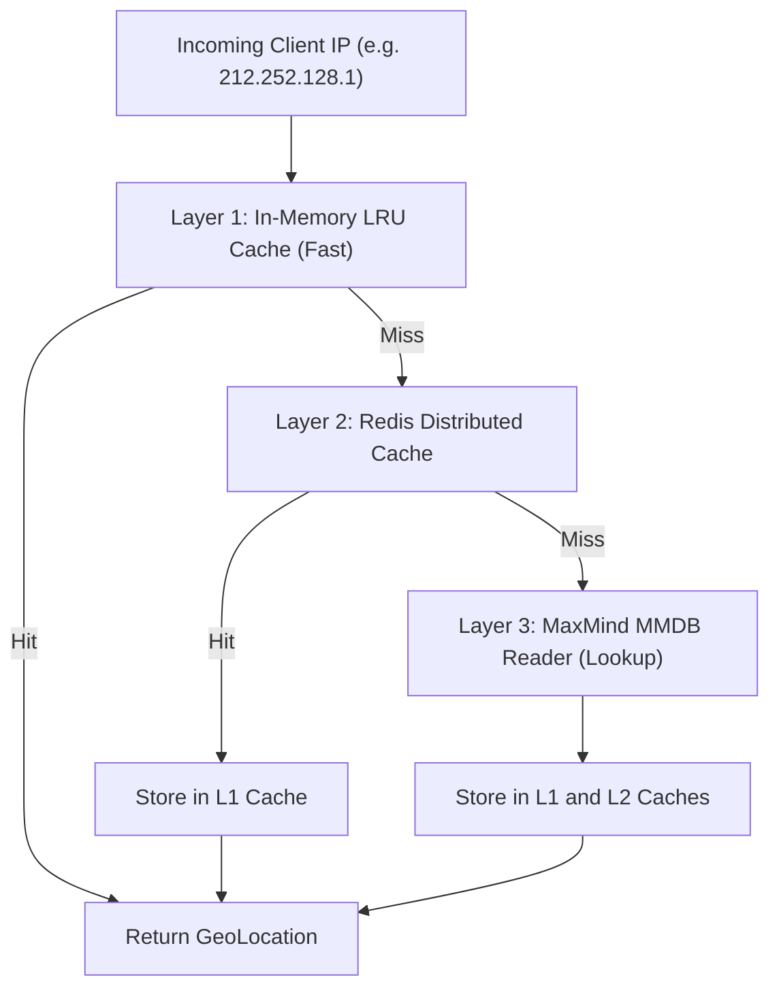

# GeoIP Engine, Auto-Update & Hot Reload

This document covers the GeoIP resolution engine, MaxMind GeoLite2 integration, automated database downloading, atomic swap, and zero-downtime hot reloading.

---

## 1. GeoIP Resolution Pipeline



### Resolved Fields
- `CountryCode`: ISO 3166-1 alpha-2 code (e.g., `"TR"`, `"US"`, `"DE"`)
- `CountryName`: Full English name (e.g., `"Turkey"`, `"United States"`)
- `City`: City name (e.g., `"Istanbul"`, `"Frankfurt"`)
- `Timezone`: IANA Timezone identifier (e.g., `"Europe/Istanbul"`, `"America/New_York"`)
- `Coordinates`: Latitude and Longitude floats

---

## 2. Automated Update & Atomic Hot Reload

MaxMind releases updated GeoLite2 databases weekly. The updater downloads, extracts, validates, and reloads the database seamlessly without interrupting in-flight requests or requiring application restarts.

### Update Workflow
1. **Download**: Fetches the archive to a temporary file (`geoip_download_*.tmp`).
2. **Extraction**: Unpacks `.tar.gz` and locates the `.mmdb` binary.
3. **Integrity & Sanity Check**:
   - Opens the temporary file with `geoip2.Open()`.
   - Runs a probe lookup query (`8.8.8.8`).
   - Reads database version and build epoch.
   - **If validation fails**: Discards the temp file, logs the error, updates status to `failed`, and preserves the active database without any interruption.
4. **Atomic Swap**:
   - Renames temporary file to `database_path` via `os.Rename` (atomic on POSIX filesystems).
   - Thread-safely updates the `GeoIPDatabase` pointer using `sync.RWMutex`.
   - Flushes in-memory and Redis caches.
   - Updates `geoip_settings.last_update_at`, `status = 'success'`, and `database_version`.

---

## 3. Administrative Control Endpoints

All endpoints require `platform.geoip.read` or `platform.geoip.manage` permissions.

### Status Endpoint: `GET /v1/platform/geoip/status`
Returns live state of the GeoIP subsystem:
```json
{
  "success": true,
  "data": {
    "enabled": true,
    "provider": "maxmind",
    "database_path": "/data/geoip/GeoLite2-City.mmdb",
    "database_loaded": true,
    "database_version": "2026-08-25 10:20:00 UTC",
    "last_update_at": "2026-08-25T10:25:00Z",
    "last_update_status": "success",
    "last_update_error": "",
    "cache_size": 1420
  }
}
```

### On-Demand Update: `POST /v1/platform/geoip/update`
Triggers an immediate download, validation, and hot reload.

### Clear Cache: `POST /v1/platform/geoip/cache/clear`
Clears in-memory and Redis GeoIP lookup caches.

### Configuration: `GET /v1/platform/geoip/config` & `PATCH /v1/platform/geoip/config`
Updates account credentials, custom download URLs, and cache settings.
Account IDs and License Keys are stored encrypted using `SecretBox` (AES-256-GCM / ChaCha20-Poly1305) and are masked in API responses (`****`).
