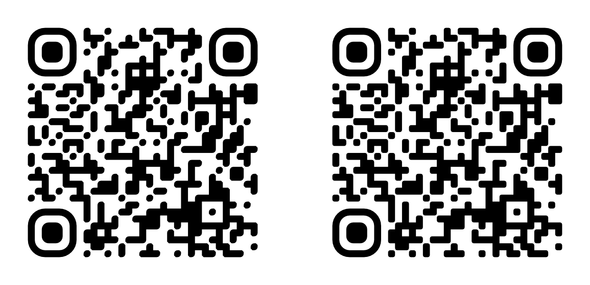
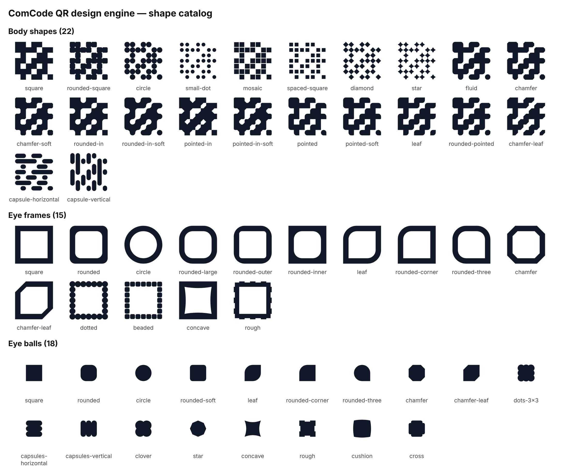
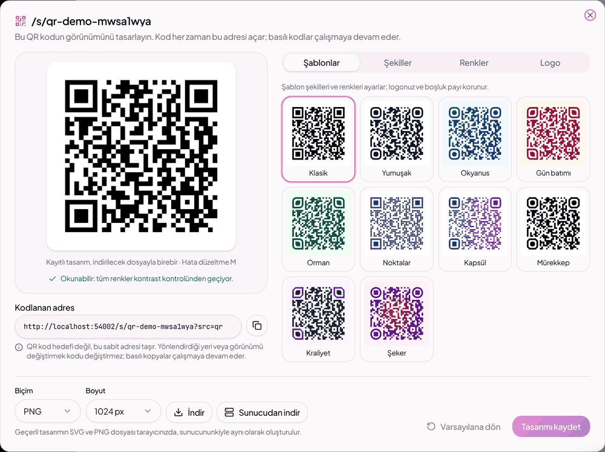
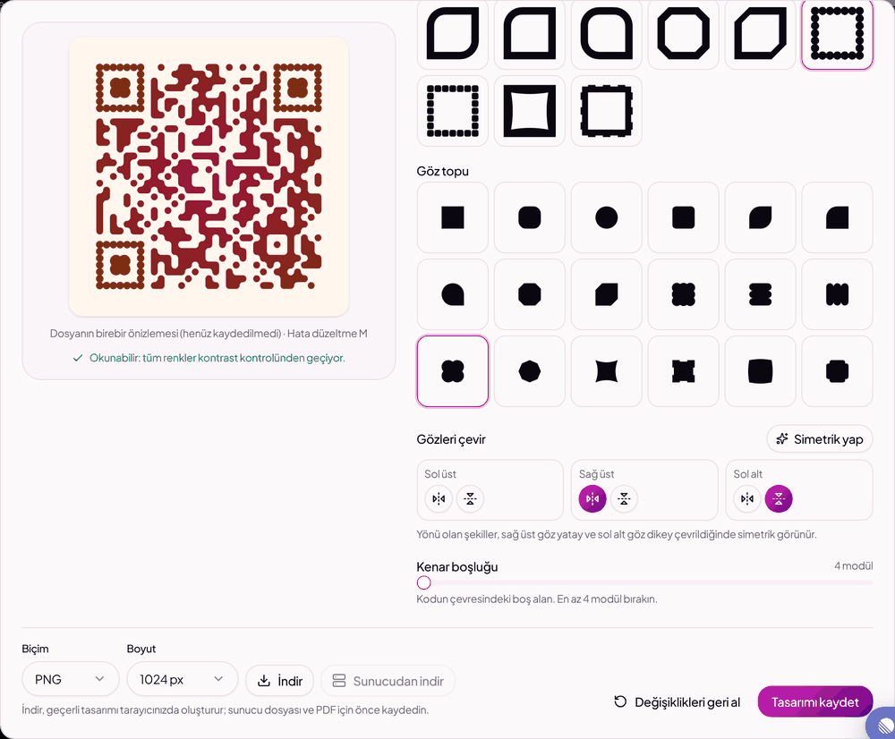
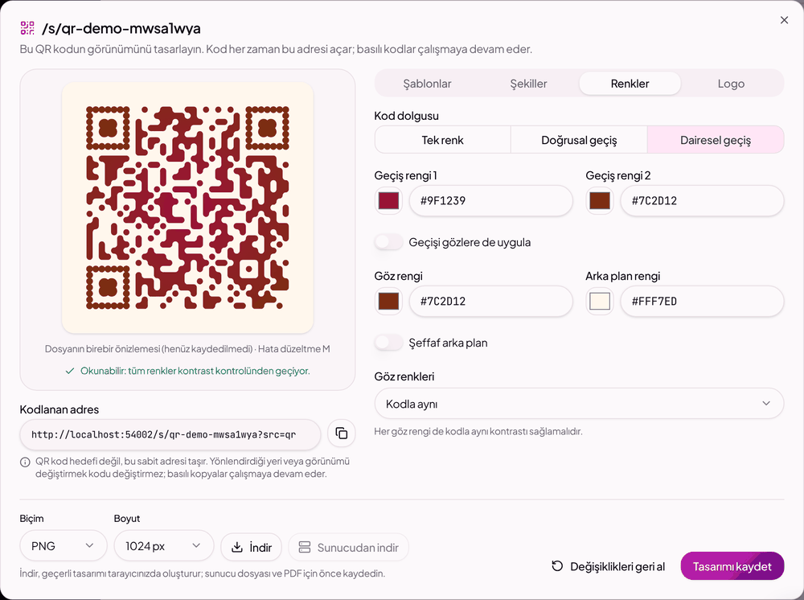
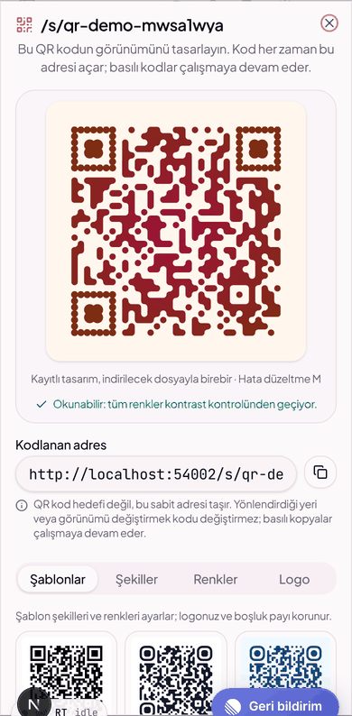

# QR design engine

Route QR codes (TEC-1268) are drawn by one design engine written twice:

- Go: `backend/internal/platform/qr/` (`style.go`, `path.go`, `shapes.go`, `render.go`). It serves
  `/v1/routes/{uuid}/qr/render` (SVG, PNG, PDF) and every server-side use.
- TypeScript: `frontend/src/features/route-qr/lib/qr-engine.ts`. The editor uses it for instant
  previews, shape swatches and browser-side SVG/PNG downloads.

For the same module matrix and style both produce the **same SVG, byte for byte**. Shared golden
fixtures enforce this (see [Fixtures](#fixtures)). The payload never changes: it is the route
identity plus `?src=qr` ([URL routing](./URL_ROUTING_AND_SMART_LINKS_ARCHITECTURE.md#smart-qr-appearance-and-downloads-tec-569)).

All shapes are ComCode's own geometry: rectangles with square, rounded or cut corners, circles and
cubic curves. No third-party QR generator code, sprites, templates or API is used.

## Style schema (v2)

The style lives in `routes.qr_style` (JSONB, no migration). The OpenAPI schema is `RouteQRStyle`.

| Field | Meaning |
|-------|---------|
| `foreground` | Solid body color; also the color of eyes without their own color. |
| `background`, `transparent_background` | Background color, or leave it unpainted. |
| `body_shape` | Data module shape ([list](#shapes)). |
| `eye_frame_shape`, `eye_ball_shape` | 7×7 finder ring and 3×3 finder center. |
| `eyes[3]` | Top-left, top-right, bottom-left: `flip_h`, `flip_v`, `frame_color`, `ball_color`. Empty colors inherit the body. |
| `fill_mode` | `solid`, `linear` or `radial`. |
| `gradient_start`, `gradient_end`, `gradient_angle` | Two gradient colors; linear angle in degrees, clockwise, 0 = left to right. Radial runs from the center to the symbol corners. |
| `gradient_on_eyes` | Eyes without their own color use the gradient instead of `foreground`. |
| `quiet_zone` | 4–16 modules. |
| `logo_profile_uuid`, `logo_field` | Same-account profile `avatar` or `cover` (API-owned media, never a URL). |
| `logo_size` | Logo width, 10–30 % of the symbol width (quiet zone excluded). Default 15. |
| `logo_mode` | `clean` removes the modules under the logo plus a one-module margin; `overlay` draws the logo over the modules. |

### Default design

A route that was never styled (`qr_style = '{}'`, the column default) is drawn with the default
design (TEC-1273, body changed in TEC-1296): `body_shape: smooth`, `eye_frame_shape: rounded-large`,
`eye_ball_shape: rounded`, black on white, quiet zone 4, no logo. The editor's "Reset to default"
selects the same style. It is defined twice, `qr.DefaultStyle` in Go and `DEFAULT_QR_STYLE` in TS,
and a test on each side pins it.

TEC-1296 replaced the default body `rounded-pointed` (two corners cut at 45°, which read as
clipped modules) with `smooth`: modules merge with their neighbors and every outer corner is
rounded (radius 0.3 module). Styles that saved `rounded-pointed` keep it.

Any saved style, even a partial one, is decoded over the v1 defaults (square shapes) as below, so
codes saved before TEC-1273 keep their look.

### Version 1 compatibility

Version 1 stored only `foreground`, `background`, `module`, `eye`, `quiet_zone` and the logo
reference. These fields stay in the schema. `qr.Style.Normalize` (and `normalizeQrStyle` in TS)
fills empty v2 fields from them and v1 fields from v2 ones:

| v1 | v2 |
|----|----|
| `module: square / rounded / dots` | `body_shape: square / rounded-square / circle` |
| `eye: square / rounded / circle` | `eye_frame_shape` and `eye_ball_shape` with the same name |
| no logo fields | `logo_mode: clean`, `logo_size: 15` (the v1 15 % logo with a one-module backing) |

A non-empty v2 field wins over its v1 field. `PUT /qr` stores the normalized v2 style; `GET /qr`
returns it with every field. `TestV1StylesKeepTheirLook` renders every v1 combination (also with a
logo) with the v1 renderer and the new one: only anti-aliased edge pixels differ.

### Validation

`qr.Style.Validate` (mirrored by `qrStyleProblems` in TS for instant feedback):

- Colors are `#rrggbb`. Every dark color in use needs 4.5:1 **directional** contrast against the
  background: `foreground`, both gradient colors when a gradient is on, and each explicit eye
  color, each checked on its own. Light-on-dark ("inverted") is rejected.
- A transparent background is judged as white (the code must sit on a light surface).
- Shapes must be in the catalogs; `gradient_angle` 0–359; quiet zone 4–16; logo size 10–30.
- A logo selects error correction **H** (otherwise M).

## Shapes

IDs are descriptive names; the order is the editor's order.

- **Body (23):** `square`, `rounded-square`, `circle`, `small-dot`, `mosaic`, `spaced-square`,
  `diamond`, `star`, `fluid`, `smooth`, `chamfer`, `chamfer-soft`, `rounded-in`, `rounded-in-soft`,
  `pointed-in`, `pointed-in-soft`, `pointed`, `pointed-soft`, `leaf`, `rounded-pointed`,
  `chamfer-leaf`, `capsule-horizontal`, `capsule-vertical`.
- **Eye frame (15):** `square`, `rounded`, `circle`, `rounded-large`, `rounded-outer`,
  `rounded-inner`, `leaf`, `rounded-corner`, `rounded-three`, `chamfer`, `chamfer-leaf`, `dotted`,
  `beaded`, `concave`, `rough`.
- **Eye ball (18):** `square`, `rounded`, `circle`, `rounded-soft`, `leaf`, `rounded-corner`,
  `rounded-three`, `chamfer`, `chamfer-leaf`, `dots-3x3`, `capsules-horizontal`,
  `capsules-vertical`, `clover`, `star`, `concave`, `rough`, `cushion`, `cross`.

Connected body shapes (`fluid`, `smooth`, `chamfer*`, `rounded-in*`, `pointed*`, `leaf`, `rounded-pointed`,
`chamfer-leaf`) look at the four orthogonal neighbors: only a corner with no dark neighbor on
either side is shaped, so runs of modules merge into one outline. The `-in` shapes also fill the
inner corner of a light cell that sits inside an L of three dark modules. Capsules merge along
their axis. Finder areas and cleared logo modules count as light, so the body never merges into
an eye or under a clean logo.

Directional eye shapes (`leaf`, `rounded-corner`, `rounded-three`, `chamfer-leaf`) are drawn for
the top-left eye; `flip_h`/`flip_v` mirror each eye, so mirrored flips make the three eyes
symmetric.

### Geometry rules that keep codes readable

Scanners find the eyes by the 1:1:3:1:1 dark/light ratio along horizontal, vertical **and
diagonal** lines through each eye, and estimate the module size from the 7-module eye width.
Every eye shape therefore keeps:

- the outer edge on the 7-module grid along the center lines (no inset outline there);
- a dark ring of roughly one module and a light gap of at least ~0.6 module on the diagonals;
- a center that is solid across its center lines and fills its diagonals (dots and capsules touch
  or overlap; stars and crosses keep a wide waist).

## Rendering

- **Geometry:** contours in module units (origin at the quiet zone's top-left), clockwise for
  fills and counter-clockwise for holes, painted with the non-zero rule. Only `+ - * /` and
  `sqrt` are used, with Go products rounded explicitly (`mul`) so no FMA changes a result; numbers
  print with three decimals, half away from zero, never `-0` (`fmtNum`).
- **SVG:** background rect, one `<path>` for the body, one per eye frame and ball, the clean logo
  backing rect and the logo `<image>` (a PNG `data:` URL on the server). A gradient is one
  `qr-fill` definition in user space (linear: across the symbol width rotated about its center).
- **PNG:** `golang.org/x/image/vector` rasterizes the same contours anti-aliased; gradients are
  computed per pixel with the SVG's definition. The logo is scaled with Catmull-Rom.
- **PDF:** A4, 160 mm square at 25 mm, vector paths; a gradient layer clips a PDF shading to the
  layer's path. The logo is embedded as PNG at the requested raster resolution.
- **Browser:** `GET /v1/routes/{uuid}/qr` returns `matrices.M` and `matrices.H` (rows of `0`/`1`),
  the exact modules the server encodes without and with a logo. `renderQrSvg(matrix, style, size,
  logoHref)` then equals `/qr/render?format=svg` (with a logo only the embedded image bytes
  differ). The npm `qrcode` encoder may pick a different mask, so it is only a fallback.

## Editor

`frontend/src/features/route-qr/components/route-qr-dialog.tsx` (TEC-1270), opened from smart
links, cards and the profile public page card:

- **Preview:** the engine draws the draft with `GET /qr`'s `matrices` (H with a logo), so the
  preview is the exact file; no server round trip while editing. The logo is read through
  `GET /v1/routes/{uuid}/qr/logo?profile_uuid=…&field=avatar|cover` (same origin, same checks as
  server renders, TEC-1271) and embedded as a `data:` URL, so browser SVG/PNG files include it.
  If that read fails, the logo is shown on top of the preview and browser downloads point to the
  server download instead.
- **Tabs:** templates (`data/qr-templates.json`, 10 own designs; a template keeps the logo, its
  size and mode, and the quiet zone), shapes (swatches drawn by the engine, per-eye flips and
  "make symmetric", quiet zone), colors (single color / linear / radial, angle, gradient on eyes,
  eye colors inherited / shared / per eye, background or transparent), logo (profile avatar or
  cover, size 10–30 %, clean or overlay).
- **Checks:** `qrStyleProblems` lists what the API would reject (each color with its role and
  contrast); `readabilityWarnings` adds advice (contrast below 7:1, logo above 22 %, overlay
  logo, transparent background, small module shapes). Save is disabled while a problem exists.
- **Downloads:** SVG and PNG of the current draft are made in the browser (`lib/qr-export.ts`:
  the engine's SVG, rasterized on a canvas for PNG), byte-identical to `/qr/render` for SVG. The
  server download (SVG, PNG, PDF) of the saved design stays; PDF is server-only.
- Templates are checked in both languages: `qr-style.test.mjs` (valid, named, distinct) and the
  Go `TestTemplatesAreReadable` (decoded with and without a 30 % logo).

## Fixtures

`backend/internal/platform/qr/testdata/*.json` each hold a fixed matrix, a style (as a client would
send it), a size, an optional logo href and the expected SVG. They cover every shape, all fill
modes, eye colors, flips, transparency, both logo modes and v1 documents.

- `go test ./internal/platform/qr` (`TestGoldenFixtures`) and `pnpm test` (`qr-engine.test.mjs`)
  both render every fixture and require exact equality. The TS test also checks that its shape
  catalogs equal the Go ones.
- After an intentional geometry change, run `make qr-fixtures`: it rewrites the fixtures with the
  Go renderer and runs the TS test. Change both engines in the same commit, review the SVG diff,
  and keep `TestV1StylesKeepTheirLook` green.

## Readability tests

`readability_test.go` renders PNGs (320 px, ≥7 px per module) and decodes them with gozxing (a
ZXing port; test-only dependency):

- every eye frame × eye ball pair, with and without a 30 % logo, with a rotating body shape;
- every body shape with three different eye pairs, with and without a logo;
- gradients, per-eye colors and flips, tinted and transparent backgrounds and both logo modes,
  all at the 4.5:1 contrast limit and the largest logo.

Each case is decoded for two real payloads (username and card route). A shape that cannot be read
fails the test; the full body × frame × ball × logo product (11,880 renders) adds no new shape to
this covering set.
