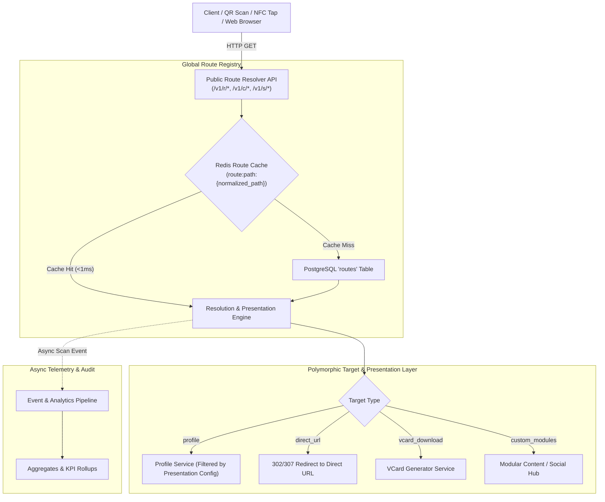
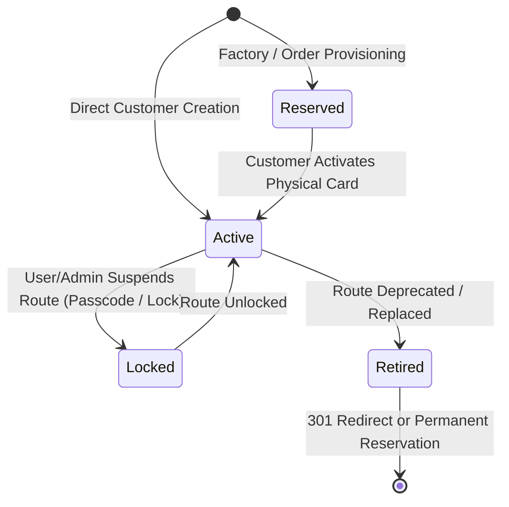
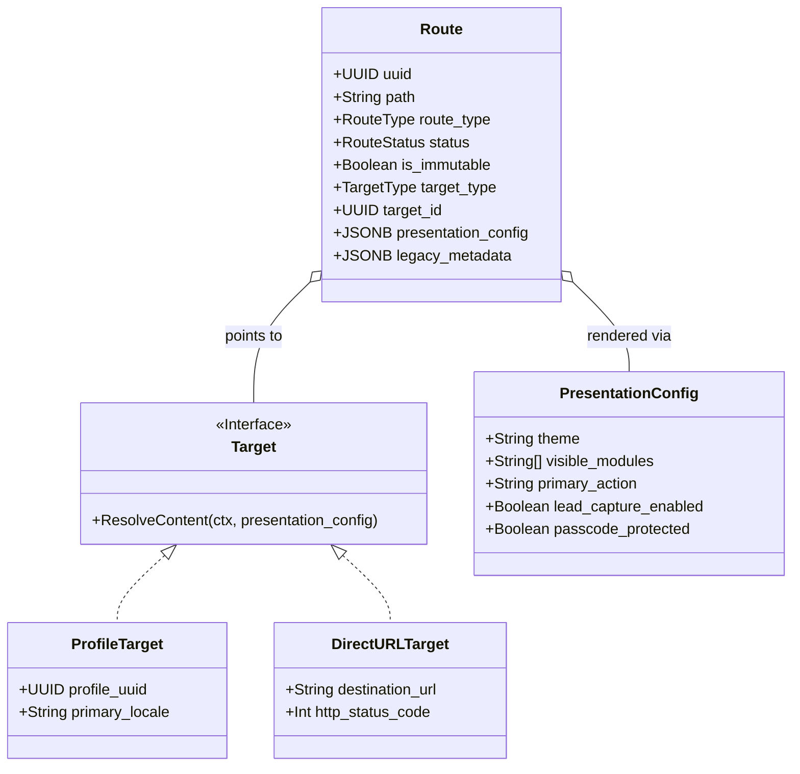
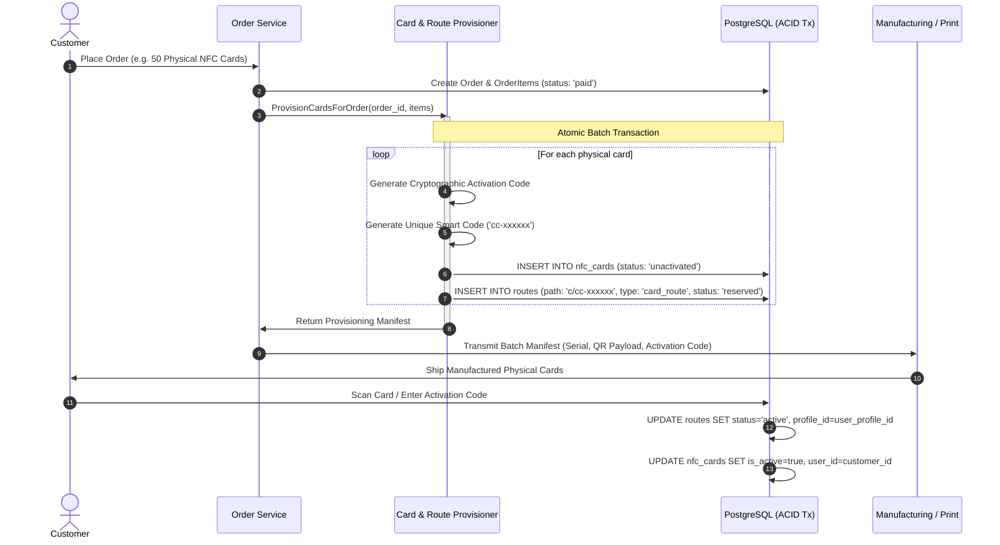
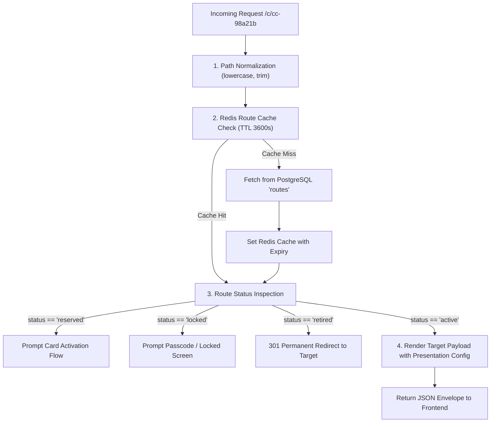

# URL Routing, Smart Links & Legacy Migration Architecture (TEC-77)

This document defines the definitive architectural specification, domain models, database contracts, provisioning workflows, and legacy migration strategy for the ComCode routing infrastructure.

---

## 1. Executive Summary & Problem Space

Previously, ComCode coupled several distinct concepts under a single "NFC Card / Smart Code" entity:
- Canonical user profile URLs (`/{username}`)
- Customer-configurable custom links (`/s/{custom_slug}`)
- Hardware/physical NFC card routes (`/c/{uuid_or_code}`)
- Legacy system hash routes (`/{legacy_hash}`)
- Target presentation configurations (e.g. which modules/vCards/direct URLs to display)

This coupling created critical structural bottlenecks:
1. **Namespace Collisions**: Inability to guarantee database-level uniqueness across heterogeneous route types.
2. **Order Provisioning Inflexibility**: Physical cards manufactured before customer assignment could not safely reserve and lock permanent URLs without hardcoding user data.
3. **Presentation Entanglement**: Changing how a profile is presented (e.g. showing only contact info vs. full profile) risked mutating the route identity or card metadata.
4. **Legacy Data Vulnerability**: Migrated legacy hashes could be overwritten, modified, or collision-checked only via soft application logic.

### Architectural Solution
ComCode establishes a **Global Route Registry & Resolution Engine** (`routes` table). Route identity (the public URL namespace) is strictly separated from downstream target entities (`profiles`, `external_urls`) and their presentation configurations.

---

## 2. High-Level System Architecture



---

## 3. Core Domain & Route Classifications

All public URLs in ComCode belong to one of four distinct route classes managed inside the unified Route Registry:

```
+--------------------------------------------------------------------------------------------------+
|                                    Global Route Registry (`routes`)                              |
+--------------------------+--------------------------+---------------------+----------------------+
| 1. Canonical Profile     | 2. Custom Smart Link     | 3. Physical Card    | 4. Legacy Route      |
|    `/{username}`         |    `/s/{custom_slug}`    |    `/c/{card_code}` |    `/{legacy_hash}`  |
+--------------------------+--------------------------+---------------------+----------------------+
| - Identity anchor        | - Marketing / Short link | - Hardware-bound    | - Migrated hash      |
| - Admin-mutable only     | - Customer-managed       | - Factory-reserved  | - Strictly immutable |
| - Root path namespace    | - `/s/` sub-namespace    | - `/c/` sub-namespace| - Root path namespace |
+--------------------------+--------------------------+---------------------+----------------------+
```

### 3.1 Route Class Definitions

| Route Type | URL Format | Mutability & Ownership | Provisioning Lifecycle | Purpose |
|---|---|---|---|---|
| `canonical_profile` | `/{username}` | **Admin-only mutable**.<br/>Owned by User / Primary Profile. | Created automatically upon User onboarding or Profile initialization. | Permanent identity URL for the user's canonical digital persona. |
| `custom_smart_link` | `/s/{slug}` | **Customer-managed**.<br/>Owned by User or Company. | Created on-demand by customer in App Dashboard. | Short links, campaign URLs, dynamic social redirects, or temporary links. |
| `card_route` | `/c/{code}` | **Identity Immutable**.<br/>Target dynamically mutable. | Allocated at Order placement / Pre-print factory stage. | Physical NFC cards, stickers, keyfobs, and laser-engraved QR codes. |
| `legacy_route` | `/{legacy_hash}` | **Strictly Immutable**.<br/>Preserves historical card identity. | Migrated via batch migration pipelines. | Backward compatibility for tens of thousands of cards in the field. |
| `system_reserved` | `/{reserved}` | **System-owned**.<br/>Immutable. | Seeded via database migrations. | Protects root namespace paths (`/platform`, `/api`, `/login`, etc.). |

### 3.2 Route Lifecycle States



- **`reserved`**: Allocated during manufacturing or order placement. Physical card is printed with `/c/{code}`, but scanning prompts the activation screen rather than showing profile data.
- **`active`**: Operational and publicly resolvable.
- **`locked`**: Temporarily suspended by owner or system (displays passcode gate or lock screen).
- **`retired`**: Route decommissioned. Kept in the registry permanently (or with a mandatory cooling-off retention period) to prevent hijacking or collision, optionally serving a 301 Permanent Redirect to a new canonical URL.

---

## 4. Separation of Route Identity, Target, and Presentation

A fundamental architectural mandate of TEC-77 is: **The URL identity must never be coupled to what it displays.**



### 4.1 Target Types (`target_type`)
- `profile`: Points to a ComCode `profiles` record.
- `direct_url`: External URL forwarding (e.g. `https://linkedin.com/in/example`).
- `vcard_download`: Generates and streams standard `.vcf` contact payload.
- `social_hub`: Renders curated links and contact cards.
- `custom_modules`: Dynamic custom block layout (bank accounts, catalog, custom buttons).

### 4.2 Presentation Configuration Specification (`presentation_config`)
The presentation layer dictates client rendering without altering the underlying target entity:

```json
{
  "theme": "dark_minimal",
  "layout_mode": "compact_card",
  "visible_modules": [
    "bio",
    "contact_phone",
    "contact_email",
    "bank_accounts",
    "social_links",
    "lead_capture"
  ],
  "primary_action": {
    "type": "save_contact",
    "label_tr": "Rehbere Kaydet",
    "label_en": "Save Contact"
  },
  "lead_capture": {
    "enabled": true,
    "prompt_title": "İletişim Bilgilerinizi Bırakın",
    "required_fields": ["name", "phone", "email"]
  },
  "security": {
    "requires_passcode": false,
    "passcode_hash": null
  }
}
```

### 4.3 Customer smart links as implemented (TEC-556)

The JSON above is the original design sketch. Customer smart links (`/s/{slug}`, `custom_smart_link`)
accept a validated subset (`SmartLinkPresentationConfig` in `backend/docs/openapi.yaml`; unknown keys
are rejected), edited in the smart link dialog (`frontend/src/features/smart-links`):

| Key | Meaning |
|-----|---------|
| `theme`, `layout_mode` | Public page theme/layout ids (`profiles/model.PublicThemes`); empty = the profile's own |
| `visible_modules` | Sections shown via the link; **only narrows** the profile's own selection |
| `primary_action.type` | `save_contact` (default), `call`, `email`, `whatsapp`, `website`; falls back to save contact without a matching contact |
| `lead_capture.enabled` | Lead form on the profile page opened through the link (only profile targets can show it) |
| `security.passcode` | Write-only; stored as an Argon2id `security.passcode_hash`. Owners read `security.passcode_enabled`, visitors never see `security` |

- **Targets:** `profile`, `social_hub` (profile page with social links only), `vcard_download` (need a
  profile) and `direct_url` (https only). `custom_modules` is not offered for smart links.
- **Presentation:** the redirect always appends `?via=s/{slug}` (TEC-940); `GET /v1/public/p/{username}?via=s/{slug}`
  applies the link's presentation when the link is active and targets that profile.
- **Passcode:** `GET /v1/s/{slug}` returns `requires_passcode: true` with no target fields; the visitor page
  shows a passcode screen and posts the passcode to `POST /v1/s/{slug}/unlock` (body only, never the URL).
  Wrong passcodes are limited in Redis per visitor+link (5), per visitor (20) and per link (50) per
  15 minutes; correct passcodes do not count.

---

## 5. Global Route Registry & Collision Prevention

### 5.1 Database Schema Specification (`routes`)

```sql
-- Global Routes Registry
CREATE TABLE routes (
    id                   BIGSERIAL PRIMARY KEY,
    uuid                 UUID         NOT NULL DEFAULT gen_random_uuid(),
    path                 VARCHAR(128) NOT NULL,
    route_type           VARCHAR(32)  NOT NULL,
    status               VARCHAR(32)  NOT NULL DEFAULT 'active',
    is_immutable         BOOLEAN      NOT NULL DEFAULT false,
    
    -- Target Association
    target_type          VARCHAR(32)  NOT NULL DEFAULT 'profile',
    target_id            UUID         NULL,
    profile_id           BIGINT       NULL REFERENCES profiles(id) ON DELETE SET NULL,
    card_id              BIGINT       NULL REFERENCES nfc_cards(id) ON DELETE SET NULL,
    direct_url           TEXT         NOT NULL DEFAULT '',
    
    -- Ownership
    owner_user_id        BIGINT       NULL REFERENCES users(id) ON DELETE SET NULL,
    company_id           BIGINT       NULL REFERENCES companies(id) ON DELETE SET NULL,
    
    -- Presentation & Legacy
    presentation_config  JSONB        NOT NULL DEFAULT '{}'::jsonb,
    legacy_metadata      JSONB        NOT NULL DEFAULT '{}'::jsonb,
    
    -- Metrics & Telemetry
    scan_count           BIGINT       NOT NULL DEFAULT 0,
    last_scanned_at      TIMESTAMPTZ  NULL,
    
    created_at           TIMESTAMPTZ  NOT NULL DEFAULT NOW(),
    updated_at           TIMESTAMPTZ  NOT NULL DEFAULT NOW(),
    deleted_at           TIMESTAMPTZ  NULL,
    
    CONSTRAINT uq_routes_uuid UNIQUE (uuid),
    CONSTRAINT chk_routes_route_type CHECK (route_type IN ('canonical_profile', 'custom_smart_link', 'card_route', 'legacy_route', 'system_reserved')),
    CONSTRAINT chk_routes_status CHECK (status IN ('reserved', 'active', 'locked', 'retired')),
    CONSTRAINT chk_routes_target_type CHECK (target_type IN ('profile', 'direct_url', 'vcard_download', 'social_hub', 'custom_modules'))
);

-- Case-insensitive Unique Index for global collision prevention
CREATE UNIQUE INDEX uq_routes_normalized_path_active
    ON routes (LOWER(TRIM(path)))
    WHERE deleted_at IS NULL;

-- Fast index for route lookups
CREATE INDEX idx_routes_lookup ON routes (LOWER(TRIM(path)), status) WHERE deleted_at IS NULL;
CREATE INDEX idx_routes_owner ON routes (owner_user_id, route_type) WHERE deleted_at IS NULL;
CREATE INDEX idx_routes_card ON routes (card_id) WHERE deleted_at IS NULL;
CREATE INDEX idx_routes_profile ON routes (profile_id) WHERE deleted_at IS NULL;
```

### 5.2 System Namespace Blacklist
Root namespace collisions are blocked at both database seed level (`route_type = 'system_reserved'`) and application validation middleware:
- Platform / Admin: `platform`, `admin`, `api`, `v1`, `v2`, `internal`, `system`
- Auth / Account: `login`, `register`, `auth`, `logout`, `verify-email`, `reset-password`, `forgot-password`, `profile`, `settings`, `account`
- Commerce / Billing: `checkout`, `billing`, `orders`, `cart`, `cards`, `products`, `plans`, `subscriptions`
- Static / Assets: `assets`, `static`, `images`, `favicon.ico`, `robots.txt`, `sitemap.xml`, `health`, `ready`, `healthz`, `readyz`
- Reserved Prefixes: `c`, `s`, `u`, `r`, `p`, `share`, `vcard`, `download`

---

## 6. Order → Card → Route Provisioning Pipeline

### 6.1 End-to-End Workflow



### 6.2 Idempotency & Bulk Fault Tolerance
1. **Idempotency Key**: Each order item provisioning executes with an deterministic idempotency key `order:{order_uuid}:item:{item_uuid}:batch`.
2. **Deterministic Resumption**: If a batch of 500 cards fails at card 342, the transaction rolls back cleanly or idempotently skips already inserted UUIDs on retry.
3. **Pre-Print Locking**: Card routes are created with `is_immutable = true` (at provisioning, before `in_production`), and the `protect_immutable_routes` trigger blocks any path or type change. On the card itself, the `protect_card_identity` trigger (migration 000043, TEC-582) rejects any change to `nfc_cards.smart_code`, and to `nfc_cards.card_uid` once it is set.

---

## 7. Legacy Migration Strategy & Immutable Preservation

### 7.1 Historical Context
Tens of thousands of legacy cards exist with hardcoded hash URLs formatted as:
`https://app.com/{legacy_hash}` (e.g. `https://comcode.co/a8f9c2d1`).

### 7.2 Migration Rules & Data Invariant
1. **Zero URL Breakage**: Every legacy hash is inserted into `routes` under `route_type = 'legacy_route'`.
2. **Strict Immutability**:
   - `routes.is_immutable = true`
   - Trigger/rule prevents modification or deletion of `path` or `legacy_metadata`.
3. **Structured `legacy_metadata` Schema**:

```json
{
  "legacy_system": "v1_legacy_platform",
  "legacy_card_id": "card_84920",
  "legacy_user_id": "usr_10294",
  "original_hash": "a8f9c2d1",
  "original_qr_url": "https://comcode.co/a8f9c2d1",
  "card_serial_number": "CC-2023-8841",
  "migration_batch": "migration_2026_q3_phase1",
  "migrated_at": "2026-08-31T21:00:00Z",
  "is_locked_legacy": true
}
```

4. **Collision Resolution Strategy**:
   If a legacy hash collides with a reserved system word, the resolver applies a deterministic fallback redirect while logging a migration alert for operator review.

---

## 8. Resolution Engine, Caching & Performance

### 8.1 Resolution Resolution Pipeline (`GET /v1/r/*`, `GET /c/*`, `GET /s/*`)



### 8.2 Cache Invalidation Policy
Implemented in `backend/internal/platform/routecache` (TEC-557). Keys carry the `app:<env>:` prefix:

| Key | Holds |
|---|---|
| `app:<env>:route:path:{normalized_path}` | Resolved route (JSON), TTL 3600s |
| `app:<env>:route:card:{card_uuid}` | Set of path keys whose entry embeds the card |
| `app:<env>:route:profile:{profile_uuid}` | Set of path keys whose entry embeds the profile |

- Only hits are cached, so creating a route (smart link, provisioning, username) needs no invalidation.
- Route update / lock toggle / delete → `DEL` of the old and new path.
- Card update, lock toggle, activation, delete → card tag fan-out.
- Profile update, avatar change, delete, public page / username change → profile tag fan-out.
- Order cancelled or refunded → its card routes become `retired` (TEC-585) and each card tag is dropped. Retired routes resolve without a target URL and show "card deactivated"; cancelled/refunded orders can no longer be provisioned.
- Without Redis, or when Redis errors, the resolver reads Postgres directly; a missed invalidation is bounded by the TTL.
- Any new write to `routes`, `nfc_cards` or `profiles` that changes what the resolver returns must call the matching `Invalidate*`.

---

## 9. Comprehensive Resolution of the 17 Architectural Questions

| # | Question | Architectural Decision & Rule |
|---|---|---|
| **1** | **Route identity vs. Target identity separation?** | Route identity is stored in `routes.path` (the public URL namespace). Target identity is stored in `routes.target_type` and `routes.profile_id`/`routes.target_id`. The presentation is governed separately in `routes.presentation_config`. |
| **2** | **What happens if a canonical profile slug changes?** | Canonical slug changes are restricted to Super Admins. Upon change, the old slug is set to `status = 'retired'`, creating a permanent 301 redirect entry pointing to the new canonical route to avoid broken links. |
| **3** | **Is redirect / history tracked for admin slug updates?** | Yes. `route_history` (migration 000044, TEC-558) stores `old_path`, `new_path`, `changed_by_user_id` and `reason` (`username_change` or `smart_link_rename`), and the change is also written to the activity log with before/after values. The old username stays as a retired `canonical_profile` route and `/{old}` answers a 301 to the new username. Card, legacy and system paths are immutable, so they never get history rows. |
| **4** | **When a custom Smart Link is deleted, is the path immediately freed?** | No. A deleted smart link is marked `status = 'retired'` with `deleted_at`, and `CheckPathExists` treats its path as taken for 30 days (TEC-559) to prevent squatting/hijacking. A renamed link's old path is held the same way through `route_history` (TEC-558); the link itself may take it back. After 30 days the path is free again; no release job is needed. Platform staff can end the hold early from Route support (`POST /v1/platform/routes/quarantine/release`, TEC-950); the rows stay for the audit trail with `quarantine_released_at` set. |
| **5** | **When is the physical card route reserved?** | During the Order Provisioning stage before physical manufacturing starts (`status = 'reserved'`). |
| **6** | **What happens if a physical card is cancelled or refunded?** | The card's route is set to `status = 'retired'`, rendering a friendly "Card Deactivated" screen. The path is never recycled. |
| **7** | **How are collisions across different route types prevented?** | Guaranteed by a single unique database index `uq_routes_normalized_path_active` across all route types in the central `routes` table. |
| **8** | **What namespace rules apply to legacy hash routes?** | Legacy hashes occupy the root namespace `/{legacy_hash}` but are checked against the system reservation blacklist during migration. |
| **9** | **Deterministic resolution for migration collisions?** | Legacy route always takes precedence for the specific hash; if conflicting with a new user registration, the new user is prompted to pick an alternative slug. |
| **10** | **Are route target changes audited?** | Yes. Recorded fail-soft via `internal/platform/activity` with full before/after snapshots of target and presentation configs. |
| **11** | **Do QR codes and NFC chips reference route identity or target?** | QR and NFC **always and exclusively** encode the immutable Route Identity URL (e.g. `https://comcode.co/c/cc-89a12b`), never the underlying target or direct profile URL. |
| **12** | **How is entity separation preserved in analytics telemetry?** | Analytics events record polymorphic dimensions: `route_id`, `card_id`, `profile_id`, and `target_type` in the event metadata payload. |
| **13** | **How does public resolver cache invalidation work?** | Invalidation is triggered on write operations by purging `route:path:{normalized_path}` and using an Asynq background worker for multi-region cache sync. |
| **14** | **Consistency model between route reservation and order transactions?** | Strong consistency (Postgres ACID Transaction). Card creation and route reservation occur in the exact same database transaction. |
| **15** | **Bulk order provisioning retry & idempotency?** | Idempotency keys per order item with chunked batch inserts (100 items per chunk) and transactional rollbacks on collision. |
| **16** | **Which fields in legacy metadata are immutable?** | `legacy_system`, `legacy_id`, `original_hash`, `original_card_serial`, `migration_batch`, and `migrated_at` are immutable. |
| **17** | **Is route history mandatory?** | Mandatory for `canonical_profile` and `card_route`. Optional for short-lived `custom_smart_link`. |

---

## 10. API Specification & Boundaries

### 10.1 Public Resolver Endpoints
- `GET /v1/r/{path}` — Universal route resolver (supports canonical profiles, legacy hashes, and short links).
- `GET /v1/c/{code}` — Dedicated physical card resolver (NFC/QR endpoint).
- `GET /v1/s/{slug}` — Dedicated custom smart link resolver.

#### Standard Resolver Response Envelope
```json
{
  "success": true,
  "data": {
    "route_uuid": "3fa85f64-5717-4562-b3fc-2c963f66afa6",
    "path": "c/cc-8819ab",
    "route_type": "card_route",
    "status": "active",
    "target_type": "profile",
    "target": {
      "profile_uuid": "e3b0c442-98fc-1c14-9afb-f4c733644265",
      "first_name": "Furkan",
      "last_name": "Meclis",
      "title": "Software Engineer",
      "company": "ComCode",
      "avatar_url": "/api/v1/storage/stream/profiles/avatar.jpg"
    },
    "presentation": {
      "theme": "dark",
      "visible_modules": ["contact", "social", "bank_accounts"],
      "primary_action": "save_contact",
      "lead_capture_enabled": false
    }
  },
  "meta": {
    "request_id": "c1f7a4e0-9a41-4c12-9c98-bc4a62174301"
  }
}
```

### 10.2 Authenticated Route Management Endpoints
- `GET /v1/routes` — List user/company managed routes (Smart Links & Cards).
- `POST /v1/routes/smart-links` — Create custom smart link.
- `PUT /v1/routes/{uuid}` — Update route target or presentation config.
- `PATCH /v1/routes/{uuid}/lock` — Toggle lock/passcode on a route.
- `DELETE /v1/routes/{uuid}` — Retire/delete custom smart link.

---

## 11. Follow-up Implementation Roadmap

Following the completion of this architecture rework gate (TEC-77), the implementation is partitioned into clear, non-overlapping tasks:

1. **TEC-70 (Smart Links & Presentation Engine)**:
   - Implement `routes` table migration and repository.
   - Build customer dashboard for `/s/{slug}` link management and presentation module selector.
2. **TEC-73 (Commerce & Card Provisioning Engine)**:
   - Implement transactional order-to-card and route batch allocation.
   - Implement activation flow (`/v1/cards/activate`).
3. **TEC-78 (Legacy Card Migration & Verifier Script)**:
   - Build Go CLI migration tool to backfill legacy cards into `routes` with immutable metadata.

## 12. Legacy migration / Eski kart geçişi (COM-560, eski TEC-560)

**Türkçe:** Doğrulanmış v1 şeması için tekrarlanabilir `migrate-legacy sync` vardır.
Sahip, geçici ve token korumalı [`export.php`](../tools/legacy-export/README.md) dosyasını FTP ile yükleyip
izinli gzip CSV tablolarını ve incremental medya manifestini sunar. Dosya cutover
tamamlanana kadar kalır, ardından silinir. Sync profil/username oluşturur ve günceller;
000051 içindeki kalıcı eşleme ve hit-ID kayıtları tekrarları tekilleştirir. `uniqid_id`
basılı immutable route olarak korunur; mutable içerik ayrı private sync metadata
tablosundadır. Kullanıcı parolaları ve settings hiçbir aşamada alınmaz.
`deactivated=1` kartları locked/inactive olur. Çakışan username yerine raporlanan
fallback canonical ad kullanılır; rezerve basılı hash bloke kalır. Ayrıntılı workflow,
offline ZIP dizin desteği ve cutover listesi CLI README içindedir. [`migrate-legacy`](../backend/cmd/migrate-legacy/README.md)
normalize CSV/JSONL kabul eder; `legacy_hash`, `target_type`, `target_value`,
`owner_email`, `owner_name`, `created_at`, `extra_json` alanlarını kullanır.

`import --dry-run` salt okunur işlem açar; gerçek import sınırlı büyüklükte atomik
batch'lerle `legacy_route`, `is_immutable=true` ve kaynak satırı/batch kimliği içeren
`legacy_metadata` kaydeder. Kaynak satırları public resolver yanıtına eklenmez.
Tekrar çalıştırma aynı kaydı değiştirmez; farklı kaynak
verisi hata verir. Varsayılan sahip üyesiz platform `legacy` bekletme hesabıdır.
`--account UUID` açık hesap seçer; `--match-owners` aktif e-postayı mevcut kullanıcının
kişisel hesabına eşler, bulunamazsa seçili hesaba döner ve rapora uyarı yazar.
Profil ve link hedefleri seçili hesaba ait olmak zorundadır.

**Kullanıcı adı çakışmaları:** Basılı hash mevcut profil/kullanıcı adı veya slug ile
çakışırsa iç kayıt `r/legacy/{hash}` olur; mevcut kayıt korunur. Mevcut frontend
`[username]` sayfasının `/public/p/{username}` çağrısı backend resolver'a bağlanır;
legacy hedef için cache'siz 307/Location döner ve sayfa ek backend çağrısı yapmadan
yönlendirir. Backend `Resolve(hash)` cache miss'te bu legacy
kaydına öncelik verir. Alias aynı route cache'ini kullanır; sıcak profil veya alias
cache hit'inde ek Postgres sorgusu yapılmaz. CLI Redis temizlemez: geçişten önce
etkilenen `app:<env>:route:path:<hash>` anahtarlarını silin veya yapılandırılmış TTL'in
(varsayılan bir saat) dolmasını bekleyin. Mevcut kök cache girdisi bu süreye kadar
eski sonucu tutar. Negatif cache kullanılmaz.

**blocked: collides with app path:** `login`, `leads`, `orders`, `account` gibi
sabit uygulama yolları ve rezerv kelimeler dry-run ve gerçek import'ta bloke edilir;
route/alias veya bekletme hesabı oluşturulmaz. Operatör CSV'si her hash'i bu açık
status altında listeler, sonunda bu başlıkla toplam sayı verir; stdout da bölüm/sayıyı
gösterir. Sahibi her durum için ayrı karar vermelidir. Frontend proxy orijinal auth
export ve matcher'ını korur; statik sayfalarda legacy API çağrısı veya yönlendirme yoktur.
Gölgelenecek profil kullanıcı adını geçişten önce değiştirin; gölgelenmiş profil/vCard
hedefleri ve kendine dönen hedefler doğrulamada reddedilir.

Rezerv kelime kontrolü yalnızca yeni kullanıcı adı atamasında ve yeniden adlandırmada
çalışır; mevcut satırları okumada veya mevcut adı korumada çalışmaz. Yeni rezerv kelime
mevcut kullanıcı adını backend'de iptal etmez. Aynı URL'de frontend statik sayfası varsa
bu tarihsel çakışma ayrıca operatör tarafından çözülmelidir.

`verify`, HTTP handler'ın kullandığı gerçek `Service.Resolve` metodunu süreç içinde,
cache/analitik olmadan her input hash'i için çağırır. Bekleneni normalize girdiden
bağımsız çıkarır; aktif legacy kayıt ve hedef eşleşmesini kontrol eder, CSV üretir,
tek hata varsa sıfır dışı çıkış kodu döner. Hedef dış sitenin erişilebilirliğini,
DNS/TLS/edge ayarlarını veya eski içeriğin tamlığını doğrulamaz. Bu değişiklik üretim
DNS/cPanel yönlendirmesini yapmaz; geçişten önce gerçek basılı URL'leri deployed edge
üzerinden kontrol edin. Bloke veya bilinmeyen hedef varsa geçiş yapmayın.

**English:** Rehearse with repeatable sync (online or offline), review dry-run reports,
then freeze legacy writes and perform final sync/edge verification on cutover day.
The normalized import/verify commands remain available for existing targets.
Profile/username collisions use internal `r/legacy/{hash}` aliases through the existing
public resolver and route cache. Evict affected root cache keys or wait for their TTL
before cutover. Static app paths/reserved words are never imported: review every row
and count under **blocked: collides with app path** with the owner. The original
frontend auth proxy is unchanged. Reserved words reject new registrations/renames;
existing usernames remain readable in the backend. Provenance remains private. No new
migration, API route, user creation or production deployment is included.

## Smart QR appearance and downloads (TEC-569)

QR appearance is stored as `routes.qr_style` (migration 000048). `GET` and `PUT
`/v1/routes/{uuid}/qr` read/replace the style; `GET /v1/routes/{uuid}/qr/render?format=svg|png|pdf&size=1024`
returns a file attachment. Reads use `app.routes.read` and the active account; writes additionally
require `app.routes.write` and an owner/admin account role. Another account's route is always 404.
Styles may be set on canonical, card, smart-link and legacy routes without changing their identities.

Defaults are black on white, square modules/eyes, a four-module quiet zone, and M error correction.
Supported modules: square/rounded/dots; eyes: square/rounded/circle. Colors are opaque `#RRGGBB`,
dark-on-light, with at least 4.5:1 relative luminance contrast. Quiet zone is 4–16 modules. Files
are 256–2048 pixels per edge and require at least four pixels per module including the quiet zone.
SVG is vector geometry; PDF is A4 with a 160 mm PNG at the requested raster resolution.

A logo uses `logo_profile_uuid` plus `logo_field: avatar|cover`, referencing existing media of a
profile in the active account. No URL or object key is accepted from the client. Storage URLs and
keys are resolved server-side and account ownership is checked again on every render. Logos must
be PNG/JPEG, at most 2 MiB and 2048 pixels per edge. They occupy the central 15% of the symbol width
with a one-module backing margin and automatically select H correction. Null `logo_profile_uuid`
and an empty/omitted `logo_field` remove the logo. Profile media changes affect future renders.

**Server preview (TEC-954).** `POST /v1/routes/{uuid}/qr/preview?format=svg|png&size=512` takes an
unsaved `RouteQRStyle` body and returns the image inline (`private, no-store`). It calls the same
`qr.Render` as `/qr/render`, so a saved style downloads byte-identical to its preview. Same read scope
as `/qr/render` (nothing is stored, so no owner/admin role); validation and logo ownership match `PUT`.
Size is capped at 256–1024, the body at 4 KiB, and requests at 600 per user per 15 minutes (Redis,
fails open). The style editor calls it debounced (400 ms); the browser-side drawing is only an
instant sketch shown until the server image for the current draft arrives.

The QR payload is a **route identity**, never `direct_url` or a profile target:
`{frontend}/{route.path}?src=qr` (e.g. `/c/abc123?src=qr`, `/s/example?src=qr`,
`/username?src=qr` or `/{legacy_hash}?src=qr`). Printed payloads never contain API/versioned paths.
Public card and smart-link pages forward the marker through their existing resolver calls;
username pages forward it through the visitor profile API. The backend records `card.qr.scan`
using the card subject when present, otherwise the route subject, with `source=qr`, route UUID
and path properties. Queue errors are logged and never prevent the visit. Activation, lock,
passcode and retirement checks and normal visit telemetry remain unchanged. The card client
fallback is unmarked because its server resolver call already attributes the scan. Metadata and
page loads share the cached profile lookup, avoiding duplicate attribution within a request.
Legacy visits pass the marker and HTTP context through `ResolveLegacy` to the shared resolver,
record exactly one route-subject QR scan, and return the same 307 redirect as unmarked visits.
The visitor handler records profile QR scans only when no legacy route matches.
Changing the target or appearance never changes the payload. Renaming a mutable smart
link still follows the existing path-history/cooldown rules; QR does not freeze its path.

The production manifest preserves `payload_url` for NFC and adds `qr_payload_url`. The QR pack,
manifest QR column and branded renderer share `platform/qr` URL builders. Existing unmarked printed
QR codes still resolve normally; they cannot reliably be distinguished from NFC/browser visits
and are not retroactively counted as QR scans. Print packs retain their unbranded default rendering.
